### 🏥 About me

- 📱 **Mobile health:** I build offline first apps for community health, so health workers can keep working without a signal
- 🛡️ **Security:** I study security operations with Wazuh SIEM and MISP threat intelligence, and practice on Hack The Box and TryHackMe
- 🧬 **Turning paperwork into data:** I like making messy, paper based processes into simple apps people actually use

### 🚀 Featured project: CHRIS

  
  

<i>Lead developer · Capstone project · Coming soon</i>

### 📊 GitHub stats

  
  

### 🔐 Other work

- **Security labs:** Wazuh, MISP and VirusTotal integration, plus hands on practice on Hack The Box and TryHackMe
- **CTF writeups:** Hack The Box and TryHackMe challenges, explained step by step
- **IoT:** Temp2Table, temperature readings from an Arduino R4 saved to MySQL

### 🎓 Certifications

- Accenture Google Career Certificate Program (Coursera, 2026)

### 📫 Contact

